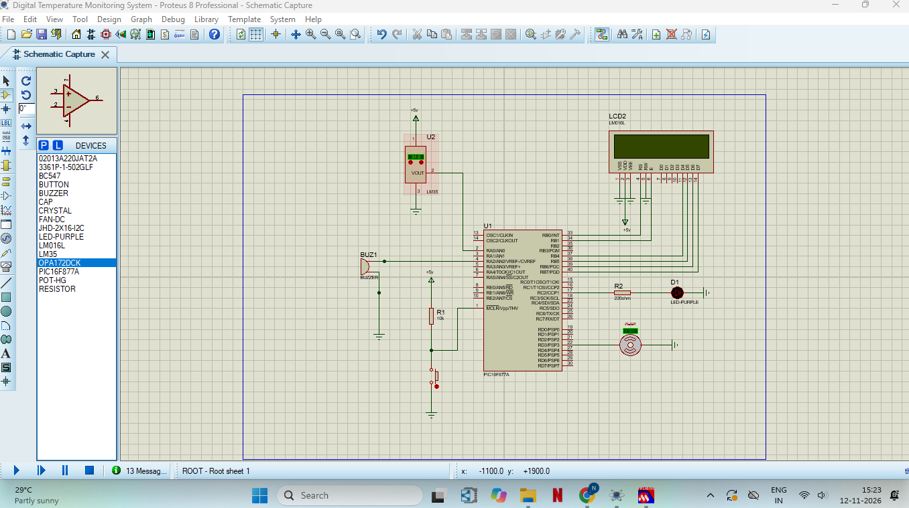
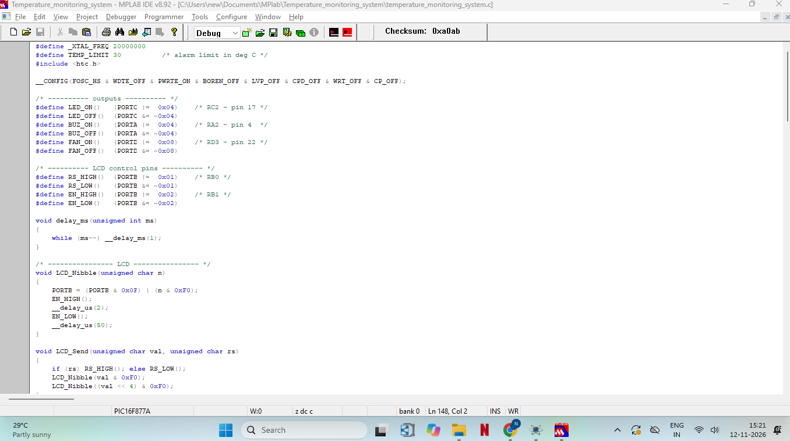
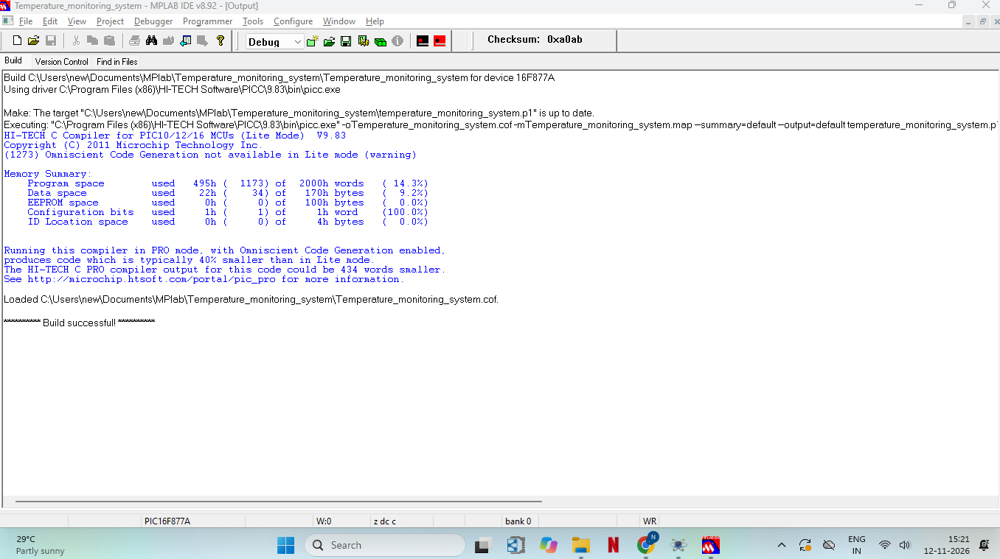
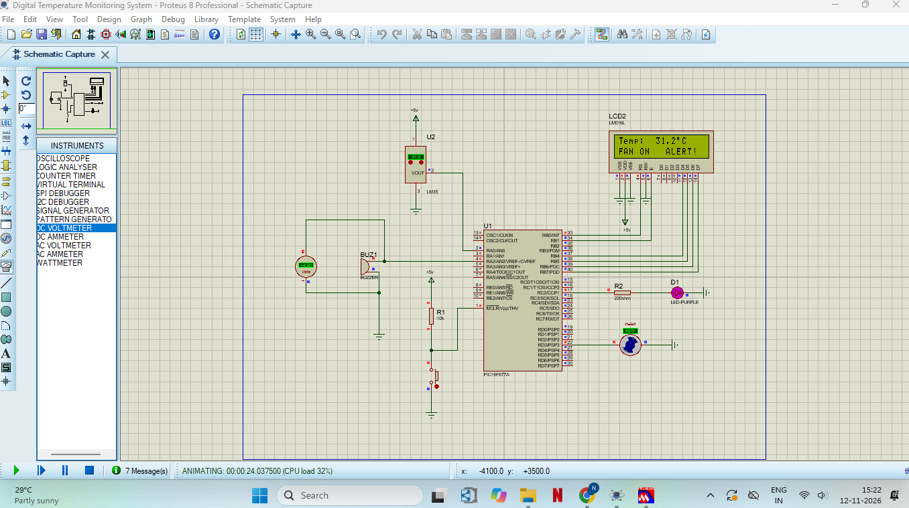
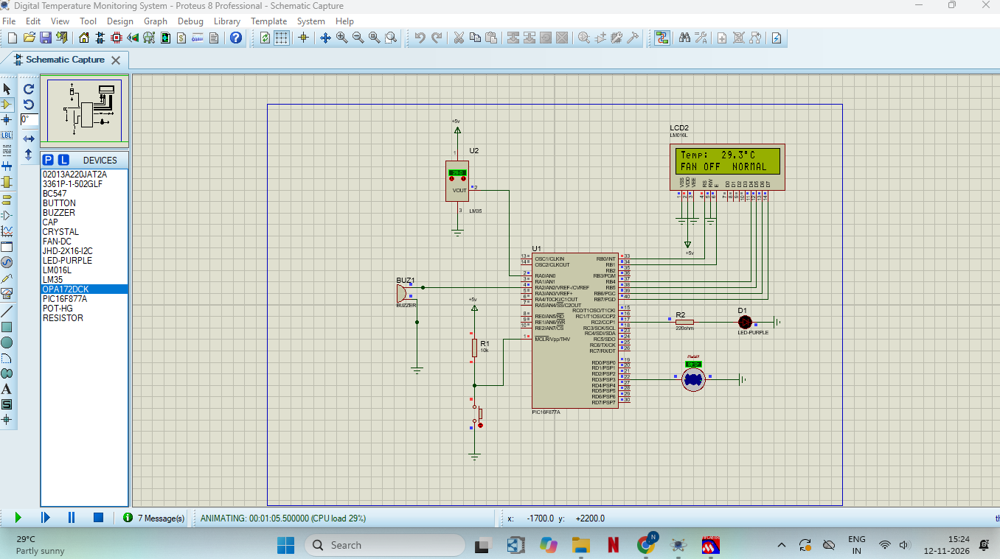
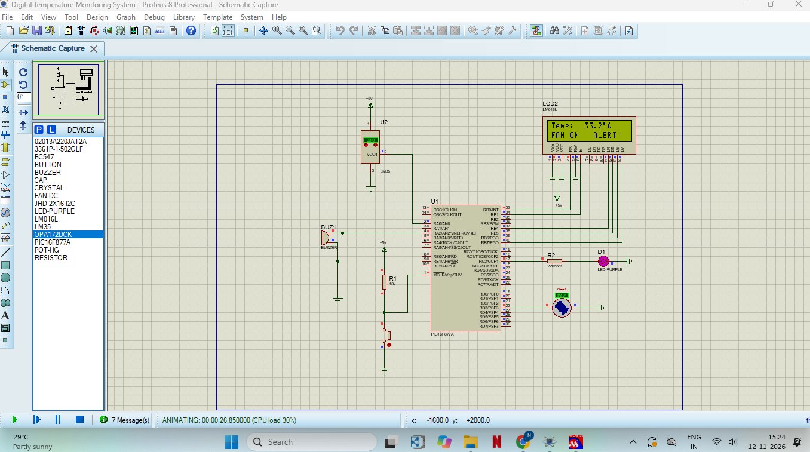

# PIC16F877A Digital Temperature Monitoring System with Automatic Fan Control using HI-TECH C and Proteus


## Project Overview

This project is a **digital temperature monitoring system** built around the **PIC16F877A** microcontroller. An **LM35** temperature sensor measures the temperature, and a **16x2 LCD** shows the reading and the system status. When the temperature goes **above 30°C**, the system automatically turns **ON a DC fan, an alert LED and a buzzer**. When the temperature drops to **30°C or below**, all three turn **OFF** automatically.

The code is written in **Embedded C**, compiled with the **HI-TECH C compiler (PICC 9.83)** inside **MPLAB IDE v8.92**, and simulated in **Proteus 8 Professional**.

This project covers four topics: reading an analog sensor with the PIC's built-in 10-bit ADC, LCD interfacing in 4-bit mode, threshold-based automatic control of outputs, and measuring a load voltage with the Proteus DC voltmeter.

## Key Features

- Real-time temperature measurement with the LM35 sensor (10 mV/°C)
- 10-bit ADC conversion on channel AN0
- Temperature shown with one decimal place, for example `Temp: 33.2°C`
- Automatic fan control: fan ON above 30°C, OFF at 30°C or below
- Visual alert (LED) and audible alert (buzzer) above 30°C
- LCD status line: `FAN ON   ALERT!` or `FAN OFF  NORMAL`
- Start-up splash screen: `DIGITAL TEMP / MONITOR SYSTEM`
- Temperature limit can be changed with one line in the code (`#define TEMP_LIMIT 30`)
- Buzzer voltage checked with the Proteus DC voltmeter
- Uses only 14.3% of the program memory of the PIC16F877A

## Working Principle

1. The LM35 gives an output voltage of 10 mV for every 1°C (for example, 300 mV at 30°C).
2. The PIC16F877A reads this voltage on **RA0/AN0** with its 10-bit ADC (0 to 1023 for 0 to 5 V).
3. The program converts the ADC value to temperature:
   `Temperature (°C) = ADC value × 500 / 1023`
4. The temperature is shown on line 1 of the LCD.
5. The program compares the temperature with the limit (30°C):
   - **Above 30°C:** the fan, LED and buzzer turn ON, and the LCD shows `FAN ON   ALERT!`
   - **30°C or below:** the fan, LED and buzzer turn OFF, and the LCD shows `FAN OFF  NORMAL`
6. The reading repeats every 300 ms.

## Components Required

| Component | Proteus Part | Value | Quantity |
|-----------|--------------|-------|----------|
| Microcontroller (U1) | PIC16F877A | - | 1 |
| Temperature sensor (U2) | LM35 | 10 mV/°C | 1 |
| 16x2 LCD (LCD2) | LM016L | - | 1 |
| DC fan | FAN-DC | 5V | 1 |
| Buzzer (BUZ1) | BUZZER | 5V | 1 |
| Alert LED (D1) | LED-PURPLE | - | 1 |
| Resistor R2 (LED) | RESISTOR | 220 ohm | 1 |
| Resistor R1 (MCLR pull-up) | RESISTOR | 10k | 1 |
| Reset push button | BUTTON | - | 1 |
| DC voltmeter (for testing) | DC VOLTMETER | - | 1 |
| Power and ground terminals | POWER / GROUND | 5V | - |

### Circuit Diagram

The circuit is drawn in Proteus 8. The LM35 is connected to PORTA, the LCD to PORTB in 4-bit mode, the LED to PORTC, the fan to PORTD, and the buzzer to RA2.



### Pin Connections

| Part | Pin | PIC Pin | PIC Port Pin |
|------|-----|---------|--------------|
| LM35 (U2) | VOUT | 2 | RA0/AN0 |
| LCD | RS | 33 | RB0 |
| LCD | E | 34 | RB1 |
| LCD | D4 to D7 | 37, 38, 39, 40 | RB4 to RB7 |
| Buzzer (BUZ1) | + | 4 | RA2 |
| Alert LED (D1) | Through R2 (220 ohm) | 17 | RC2 |
| DC fan | + | 22 | RD3 |
| MCLR | Through R1 (10k) to VCC, reset button to GND | 1 | MCLR |

- **LM35:** pin 1 to VCC (+5V), pin 3 to GND.
- **LCD:** VSS, VEE and RW go to GND, and VDD goes to VCC. D0 to D3 are not connected.
- **LED, buzzer and fan:** the negative side of each goes to GND.

## Source Code

The complete program is in the file `temperature_monitoring_system.c`. It contains the LCD driver, the ADC routine and the temperature control logic.

To change the temperature limit, edit this line at the top of the file:

```c
#define TEMP_LIMIT 30          /* alarm limit in deg C */
```

## Setup Process

### Step 1: Select the Device in MPLAB IDE

In MPLAB IDE v8.92, click **Configure → Select Device** and choose **PIC16F877A**.

### Step 2: Create the Project

Click **Project → Project Wizard**. Choose the device PIC16F877A, select **HI-TECH Universal ToolSuite** as the language toolsuite, and finish the wizard with a project name and folder.

### Step 3: Create the C File

Create a new file, paste the program in it, and save it as `temperature_monitoring_system.c` in the project folder. Then right-click **Source Files** in the project window, choose **Add Files**, and select the `.c` file.



### Step 4: Build the Project

Click **Project → Build All**. The Output window should end with `Build successful!`. The build creates the HEX file `Temperature_monitoring_system.hex` in the project folder.



**Build result (HI-TECH C 9.83, Lite mode):**

| Memory | Used | Available | Percentage |
|--------|------|-----------|------------|
| Program space | 1173 words | 8192 words | 14.3% |
| Data space | 34 bytes | 368 bytes | 9.2% |

### Step 5: Load the HEX File in Proteus

Double-click the PIC16F877A in Proteus, click the folder icon next to **Program File**, and select the HEX file. Then set the following properties:

| Property | Value |
|----------|-------|
| Program File | `Temperature_monitoring_system.hex` |
| Processor Clock Frequency | 20MHz |

The configuration bits (HS oscillator, watchdog timer OFF, power-up timer ON, brown-out reset OFF, low-voltage programming OFF) are set inside the code with `__CONFIG`, so they load with the HEX file.

### Step 6: Set the Buzzer Properties

Double-click the buzzer (BUZ1) and set:

| Property | Value |
|----------|-------|
| Operating Voltage | 5V |
| Load Resistance | 1k |
| Exclude from Simulation | Unticked |

**Why 1k?** The default load resistance is 12 ohm. At 5V, that would ask for about 400 mA, which is far more than a PIC pin can supply (about 25 mA). The pin voltage then collapses and the buzzer stays silent. With 1k, the buzzer draws only about 5 mA, which the pin can supply easily.

### Step 7: Measure the Buzzer Voltage with the DC Voltmeter

A DC voltmeter shows whether the buzzer is actually getting power. This is useful because the Proteus buzzer has no visual animation; you can only hear it.

1. Click the **Virtual Instruments Mode** icon on the left toolbar of Proteus.
2. Select **DC VOLTMETER** from the Instruments list and place it on the sheet.
3. Connect the voltmeter **+** terminal to the buzzer **+** pin (the wire from RA2).
4. Connect the voltmeter **−** terminal to **GND** (the buzzer − side).
5. Run the simulation and change the LM35 temperature with its ▲ ▼ buttons.

| Condition | Voltmeter Reading | Buzzer |
|-----------|-------------------|--------|
| Temperature above 30°C | about +5.00 V | ON (beeps) |
| Temperature 30°C or below | about 0.00 V | OFF |



If the voltmeter shows only a fraction of a volt during ALERT, the buzzer's load resistance is too low. Check Step 6.

### Step 8: Run the Simulation

Click the **Play** button at the bottom left of Proteus. The LCD first shows **DIGITAL TEMP / MONITOR SYSTEM**, then the live temperature. Use the ▲ ▼ buttons on the LM35 to change the temperature.

## Output

The default temperature limit is **30°C**.

| Temperature | LCD Line 1 | LCD Line 2 | Fan | LED | Buzzer |
|-------------|------------|------------|-----|-----|--------|
| Simulation starts | DIGITAL TEMP | MONITOR SYSTEM | OFF | OFF | OFF |
| 30°C or below | Temp: 29.3°C | FAN OFF  NORMAL | OFF | OFF | OFF |
| Above 30°C | Temp: 33.2°C | FAN ON   ALERT! | ON | ON | ON |

### Below 30°C: Normal

The fan, LED and buzzer are OFF.



### Above 30°C: Alert

The fan spins, the LED glows and the buzzer beeps.



**Demo video:** [Watch the demo](https://drive.google.com/file/d/1aNz6tNJ7YBIxJ-wI3qxbhh_2N677vORa/view?usp=drivesdk)

## Simulation Notes

- **Crystal:** Proteus does not simulate the crystal. The clock comes from the **Processor Clock Frequency** property (20MHz). On real hardware, a 20MHz crystal with two 22pF capacitors to GND is needed on pins 13 and 14.
- **Fan and buzzer drive:** in this simulation, the fan and buzzer are driven directly from the PIC pins. On real hardware, they need a transistor driver (for example BC547 or 2N2222 with a 1k base resistor), and the fan needs a 1N4007 flyback diode, because a PIC pin can supply only about 25 mA.

## Future Improvements

- Adjustable temperature limit with a potentiometer or push buttons
- Fan speed control with PWM (CCP module) based on temperature
- Temperature logging to a PC through UART
- IoT monitoring with an ESP8266 or ESP32 module
